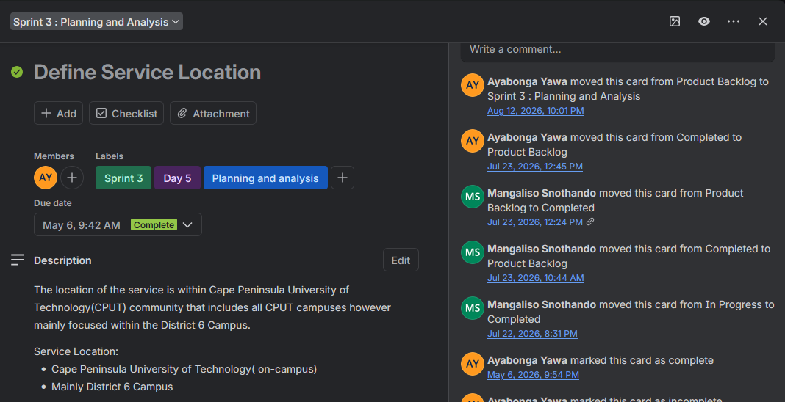
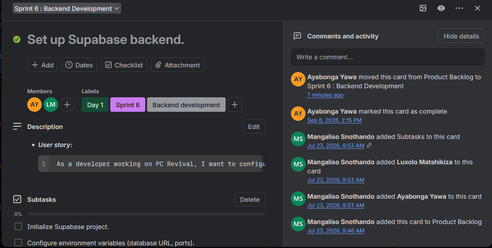
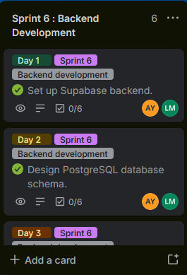

# Ayabonga Jervasio Yawa

**ICT Application Development Student | Intern Developer | CPUT**  
**Student number:** 221241558

- 📍 D83 OR Tambo Road, Cape Town, South Africa
- 📧 [221241558@mycput.ac.za](mailto:221241558@mycput.ac.za)
- 📞 076-634-0277
- 🐙 [GitHub](https://github.com/JerivasioYawa)
- 🔗 [LinkedIn](https://www.linkedin.com/in/ayabonga-yawa-b47966239/)

This portfolio brings together my professional background, PC Revival project evidence and reflections on learning to plan, build and review software with a team. It also describes my Work Integrated Learning experience at Full Stack (Pty) Ltd. Shared artefacts show the team's context; my reflections explain my own contribution and learning.

## Contents

1. [GitHub Student Account](#github-student-account)
2. [My CV](#my-cv)
3. [Mock Interview Video](#mock-interview-video)
4. [Published GitHub Pages](#published-github-pages)
5. [Agile Team Charter](#agile-team-charter)
6. [User Stories and Tasks](#user-stories-and-tasks)
7. [Product Backlog](#product-backlog)
8. [Sprint Backlog](#sprint-backlog)
9. [Agile Logbook](#agile-logbook)
10. [Work Integrated Learning](#work-integrated-learning)
11. [Learning Connections](#learning-connections)

---

## GitHub Student Account

[View my GitHub account](https://github.com/JerivasioYawa) · [Portfolio repository](https://github.com/JerivasioYawa/portfolio)

I have access to the GitHub Student Developer Pack. I use GitHub to organise my repositories, maintain version history and share my academic work.

### Reflection

- **Situation:** My development work and academic evidence needed an organised place where others could review them.
- **Task:** Establish a professional GitHub presence and present my work clearly.
- **Action:** I used my GitHub account to maintain project repositories and assembled this portfolio around linked evidence and individual reflections.
- **Result:** My work has a central location for review. I have learned that a useful repository needs understandable documentation as well as source code.

---

## My CV

### Professional Summary

I am a final-year Information and Communication Technology student specialising in Application Development at the Cape Peninsula University of Technology. My academic work has given me experience with Java, Python, PHP, relational databases and user-facing applications. I am currently an Intern Developer at Full Stack (Pty) Ltd, where I am developing my debugging, testing and collaboration skills in a professional environment.

I am interested in junior software development and backend development opportunities where I can contribute, learn from experienced developers and build reliable applications.

### Education

| Qualification | Institution | Period |
|---|---|---|
| Diploma in Information and Communication Technology | Cape Peninsula University of Technology | 2023–Present |
| Higher Certificate in Information and Communication Technology | Cape Peninsula University of Technology | 2022–2023 |
| National Senior Certificate | Silikamva High School | 2019 |

### Technical Skills

| Category | Skills and technologies |
|---|---|
| Programming | Java, Python, PHP, JavaScript |
| Web development | HTML5, CSS3, Laravel |
| Database development | MySQL, SQLite, Apache Derby; PostgreSQL/Supabase project exposure |
| Design and implementation | Object-oriented programming, DAO pattern, JDBC, client-server communication |
| Tools | Git, GitHub, Trello, VS Code, IntelliJ IDEA, NetBeans, XAMPP |
| Operating systems | Windows, Linux/Ubuntu |
| Developing workplace skills | Bug investigation, testing, pull-request workflows and Agile communication |

### Work Experience

#### Intern Developer — Full Stack (Pty) Ltd

**17 September 2026–Present**

- Participate in developer onboarding, team communication and Agile stand-ups.
- Investigate application defects and contribute fixes within the company's development workflow.
- Test changes and participate in the review process before further deployment.
- Develop my understanding of repositories, build pipelines and collaborative software delivery.

The employer owns the project and its implementation. This public portfolio contains no company source code, internal repository links, credentials or proprietary implementation artefacts.

#### Data Annotator — Enlabeler

**November 2021–June 2022**

- Annotated data using digital annotation tools and internal quality processes.
- Checked work for consistency and helped identify errors.
- Collaborated with colleagues to maintain productivity and improve workflow quality.

### Projects

#### PC Revival — Student Technology Services

**Team project | Design support, task organisation and sprint planning**

PC Revival addresses students' need for affordable laptop repairs, upgrades and refurbished devices, with a focus on the CPUT community and District Six Campus.

My documented work includes updating the Trello board, assigning tasks, working on the ERD, developing About-page wireframes and mockups, building the prototype and UI, and checking responsiveness. AY-labelled cards also identify my participation in service-location planning and backend setup/schema work.

[Project repository](https://github.com/JerivasioYawa/PC-Revival) · [Shared Trello board](https://trello.com/b/68sMqKP5/pc-revival-project-progress)

#### Student Enrollment System

**Java | Java Swing | Apache Derby | JDBC**

- Developed a client-server application using socket programming.
- Built a graphical interface for enrollment and course management.
- Applied object-oriented principles and the DAO pattern to separate responsibilities.
- Used JDBC to work with relational database tables.

#### Python Library Management System

**Python | SQLite3 | Git**

- Developed a console-based library management application.
- Implemented inventory, user registration and borrowing/return workflows.
- Applied object-oriented programming and persistent SQLite storage.
- Used Git for version control.

### References

| Name | Organisation and position | Contact |
|---|---|---|
| Lugcino Ngqaza | Enlabeler — Squad Leader | +27 65 729 4319 |
| Berna van Rooijen | Enlabeler — Project Manager | berna@enlabeler.com / +27 60 606 0505 |

### CV Reflection

- **Situation:** My original README mainly listed my qualifications and technical skills.
- **Task:** Present my experience in a way that connects skills to actual work.
- **Action:** I organised my education, employment and projects into clear sections and linked PC Revival contributions to supporting evidence.
- **Result:** The portfolio gives readers more context for my skills. This process helped me distinguish between listing a technology and explaining how I used it.

---

####  🎥 Mock Interview Video

  <video width="640" controls preload="metadata" playsinline style="display:block;max-width:100%;height:auto;margin:0 0 16px 0;">
    <source src="https://github.com/user-attachments/assets/e9689401-379b-4676-81cb-a79136fa08e3" type="video/mp4">
    <a href="https://github.com/user-attachments/assets/e9689401-379b-4676-81cb-a79136fa08e3">Watch my mock interview video</a>
  </video>

  

######  💭 Mock Interview Video Reflection

- **Situation :** Preparing for employment requires me to communicate my experience as well as demonstrate technical work.
- **Task :** Present myself through a recorded mock interview.
- **Action :** I completed the recording and included it alongside my CV and project evidence.
- **Result :** The recording provides a concrete artefact for reviewing my delivery. My development goal is to use specific project examples and keep explanations concise; I do not claim a measured improvement without feedback evidence.

---

## Published GitHub Pages

[🌐 Open my portfolio](https://jerivasioyawa.github.io/portfolio/) · [View source README](https://github.com/JerivasioYawa/portfolio/blob/main/README.md)

The portfolio is prepared for GitHub Pages publishing from the repository's `main` branch and root folder. The website presents the same content as this README, with relative links to its evidence. It requires no application credentials or environment variables.

### Reflection

- **Situation:** A repository alone is not the most convenient entry point for every assessor or recruiter.
- **Task:** Make my portfolio accessible through a website while retaining its version-controlled source.
- **Action:** I organised the README and supporting files for branch-based GitHub Pages publication.
- **Result:** The portfolio has a consistent source structure for both repository and website readers. Checking publication and evidence links is part of completing the submission, rather than assuming a commit alone proves the site is available.

---

####  📜 Agile Team Charter

This is the shared PC Revival team charter. It brings together the team's purpose, values and working agreements. My reflection below focuses on my own participation in design support, task organisation and sprint planning.

######  💭 Agile Team Charter Reflection

- **Situation :** PC Revival required several people to coordinate research, design and development, with recurring communication and participation difficulties.
- **Task :** Understand my responsibilities and plan my work within the team's shared agreements.
- **Action :** I worked within the design-support role and contributed to task organisation and sprint planning. I used the board and logbook to make planned work and blockers visible.
- **Result :** The charter provided a shared reference for responsibilities, but the logbooks show that coordination still needed attention. I learned that agreements become useful when the team follows them through in day-to-day work.

---

####  📝 User Stories and Tasks

The following examples connect user needs to the tasks visible in the evidence. 

| Evidence | User need expressed as a story | Visible tasks and ownership |
|---|---|---|
| Define Service Location | As a CPUT student, I want to know where the service operates so that I can judge whether it is accessible to me. | Card identifies CPUT campuses with a District Six focus; Ayabonga Yawa(AY) is assigned. |
| Set up Supabase backend | As a developer working on PC Revival, I want a configured backend so that the application can connect to its data services. | Initialise the Supabase project; configure environment variables. Ayabonga Yawa(AY) and Luxolo Matshikiza(LM) are assigned. |
| Design PostgreSQL database schema | As a developer, I want a defined database schema so that application data has a clear structure. | Sprint 6 Day 2 card assigned to Ayabonga Yawa(AY) and Luxolo Matshikiza(LM); its six checklist items are not expanded in the supplied image. |

######  💭 User Stories and Tasks Reflection

- **Situation :** Broad activities such as backend development were too large to communicate as a single task.
- **Task :** Participate in planning work that team members could understand and track.
- **Action :** I helped organise sprint work and was assigned to cards linking a feature or development need to specific tasks. The setup card separates project initialisation from environment configuration.
- **Result :** The evidence gives a clearer account of the work and its owners. It also taught me to keep a user story, its implementation tasks and its completion checks consistent. The screenshot credits Mangaliso with adding subtasks; I do not claim sole authorship of those checklists.

---

####  📋 Product Backlog

The product backlog brings together upcoming PC Revival work. The logbooks describe research, business planning, design, backend development, integration/testing, deployment and post-launch work. These are the recorded scope areas.

The AY activity in the supplied screenshots shows **Define Service Location** moving from Product Backlog to Sprint 3 and **Set up Supabase backend** moving from Product Backlog to Sprint 6. This demonstrates the link between the broader backlog and selected sprint work. The available screenshots do not establish a complete backlog count or the priority of every card.

[View service-location movement](evidence/ay-service-location.png) · [View backend movement](evidence/ay-backend-setup.png)

######  💭 Product Backlog Reflection

- **Situation :** The team needed to keep track of work across business planning, interface design and backend preparation.
- **Task :** Help organise the board so that upcoming work and sprint work were distinguishable.
- **Action :** I updated the board and assigned members, as recorded on 4 August. The screenshots also record my movement of cards from the product backlog into sprint lists.
- **Result :** The board provides a visible record of scope and selection. My main learning is that moving a card is an organisational action; it should not be confused with proof that the underlying feature has been implemented or tested.

---

####  🏃 Sprint Backlog

**Sprint 6 focus:** prepare the backend foundation for PC Revival. The visible sequence places backend setup before schema design. The logbook additionally lists authentication tables, table relationships, connection testing, CRUD endpoints, booking logic and admin authentication as backend work.

| Sprint item | Visible scheduling | Members | Evidence limitation |
|---|---|---|---|
| Set up Supabase backend | Sprint 6, Day 1 | AY, Luxolo Matshikiza(LM) | Card marked complete; checklist displays 0/6. Activity records completion on 6 September 2026. |
| Design PostgreSQL database schema | Sprint 6, Day 2 | AY, Luxolo Matshikiza(LM) | Card marked complete; checklist displays 0/6. No detailed test result is visible. |
| Define Service Location | Sprint 3, Day 5 | AY | Card activity records movement into Sprint 3 on 12 August 2026. |

######  💭 Sprint Backlog Reflection

- **Situation :** The team had several backend dependencies to organise, while the logbooks recorded communication and coordination challenges.
- **Task :** Contribute to sprint planning and make responsibilities and the next pieces of work clearer.
- **Action :** I updated the board, assigned members and moved work into sprint lists. The AY-labelled evidence connects me to service-location planning and the backend setup/schema sequence.
- **Result :** The screenshots provide traceable evidence of my planning participation and shared assignments. 

---

## Agile Logbook

[📓 Corrected July logbook: 14–17 July](evidence/agile-logbook-14-17-july.md)  
[📓 Original August logbook: 4–7 August](evidence/agile-logbook-04-07-august.docx)  
[📓 Backend-focused review: 10–14 August](evidence/agile-logbook-10-14-august.md)

| Period | Focus | Evidence treatment |
|---|---|---|
| 14–17 July 2026 | Value proposition, presentation preparation, lecturer feedback and refinement | Corrected transcription excludes the original out-of-range 13 July entry. |
| 4–7 August 2026 | Trello organisation, ERD work, About-page design/UI and responsiveness | Original uploaded document retained. |
| 10–14 August 2026 | Backend scope and preparation | Retrospective clarification separates recorded backend scope from unverified daily implementation outcomes. |

### Reflection

- **Situation:** Work moved from business planning into interface development and backend preparation, while time management and communication remained recurring issues.
- **Task:** Record progress, planned work and impediments so that the team could review its decisions.
- **Action:** I recorded daily updates and used the taskboard to organise upcoming work. During portfolio preparation, I also reconciled the July date range and separated backend planning from the repeated presentation text in the August source.
- **Result:** The records connect my About-page work and sprint-planning activity to specific artefacts. Reviewing them showed me why accurate dates and clear status descriptions matter. My next improvement is to record test results and retrospective actions alongside daily progress, rather than relying on a completed-card label.

---

####  💼 Work Integrated Learning

- 🏢 **Employer:** Full Stack (Pty) Ltd
- 💻 **Role:** Intern Developer
- 📅 **Start date:** 17 September 2026

The September report and attendance register cover my onboarding, bug investigations, testing and participation in the team's development workflow. The general five-month WIL plan in the report refers to the academic programme; my placement started on 17 September 2026.

The public copy has my national ID removed. Mentor-signature and other incomplete fields remain as supplied, so the register is supporting evidence.

---

######  📱 ATKV Mobile Application Development Project

Work Integrated Learning | Progressive Web Application | Full Stack (Pty) Ltd

I am currently working on the ATKV Mobile Application Development project as part of my WIL placement. The project focuses on creating a unified Progressive Web Application (PWA) that improves how ATKV members access services and assists with managing day-to-day operations.

######  📘 Project Overview

The application is being developed using .NET 9 and Blazor WebAssembly, with support for both Afrikaans and English. It is intended to provide members with one platform for accessing their information, payments, bookings and communication, while connecting to existing systems such as iMIS, Freshdesk, 1Tick, Nightsbridge and MaintainX.

The scope below describes the project's planned capabilities and indicative delivery periods. It provides context for the project I am working on; it does not mean that I personally developed every feature or that all features have been completed.

######  🛠️ Version 1 — Planned Scope (6–8 Months)

- **Member Services:** Member profile management and the display of family information.
- **Dual Wallet System:** A standard wallet for payments and a Tjieng Rewards wallet for spending within ATKV.
- **NFC Integration:** Armband integration to support transactions at the resorts.
- **Communication Hub:** Subscription-based news feeds for resorts, branches and cultural projects.
- **Booking Management:** Viewing active bookings, with 1Tick integration for indemnity requirements.
- **Support Integration:** A Freshdesk-integrated contact system for support tickets and manual bookings.

######  🚀 Version 2 — Planned Scope (12–14 Months)

- **Advanced Booking:** Nightsbridge integration to support an automated booking engine.
- **Cultural Projects:** Digital entries, payments and document uploads.
- **Governance:** Branch management tools and an Annual General Meeting (AGM) voting system.
- **Maintenance:** MaintainX integration for submitting maintenance requests while at a resort.

######  🧰 Technical Architecture

- **Platform:** .NET 9 with Blazor WebAssembly PWA.
- **Infrastructure:** Azure-native microservices architecture.
- **Integration:** RESTful APIs connecting the core business systems.
- **Security:** Enterprise-grade security and comprehensive audit trails form part of the stated architecture requirements.

######  💻 My Contribution

- Investigating reported bugs and identifying possible causes within the application.
- Working on assigned fixes and testing the affected functionality.
- Following the team's review and deployment workflow.
- Participating in daily stand-ups to communicate progress and raise blockers.
- Building my understanding of the existing application structure and how its components work together.

######  🔒 Project Evidence and Confidentiality

This overview describes the project I am involved in, while the linked WIL report and register provide supporting evidence of my placement and recorded activities. The application and its implementation belong to the company. Source code, internal repositories, credentials and company implementation artefacts are therefore not included in this portfolio.

######  💭 Work Integrated Learning Reflection

- **Situation :** During my WIL placement at Full Stack, I joined the ATKV mobile application project and had to become familiar with an existing application and the team's way of working.
- **Task :** My responsibility was to assist with assigned bug investigations and fixes, test the changes and follow the development process used by the team.
- **Action :** I worked through the reported issues, investigated the affected functionality and tested changes before they moved further through the review process. I also participated in stand-ups to provide updates and discuss any blockers.
- **Result :** This work has given me practical experience in maintaining an existing application and working with a development team. I am improving my understanding of debugging, testing and the importance of checking how a change affects other parts of the system.

---

## Learning Connections

PC Revival helped me connect requirements, design and planning: a student need informs a task, a task enters a sprint, and the logbook records what happened. My WIL experience extends that learning into professional review and testing practices.

The most useful lesson from assembling this portfolio is that evidence must support the claim being made. A design artefact supports design work, a board activity supports planning participation, and a test result would support a claim about behaviour. They are related, but they are not interchangeable.

My next goals are to write clearer acceptance criteria, keep card and checklist statuses aligned, and record specific test outcomes and actions from retrospectives. These habits will make both my development work and future reflections more reliable.
